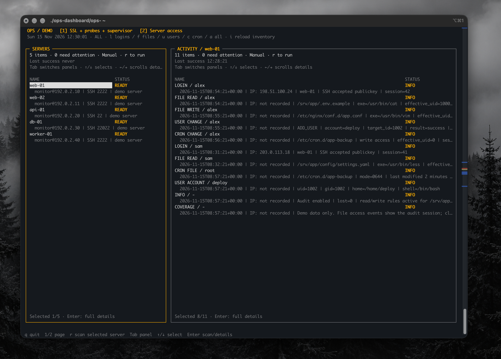
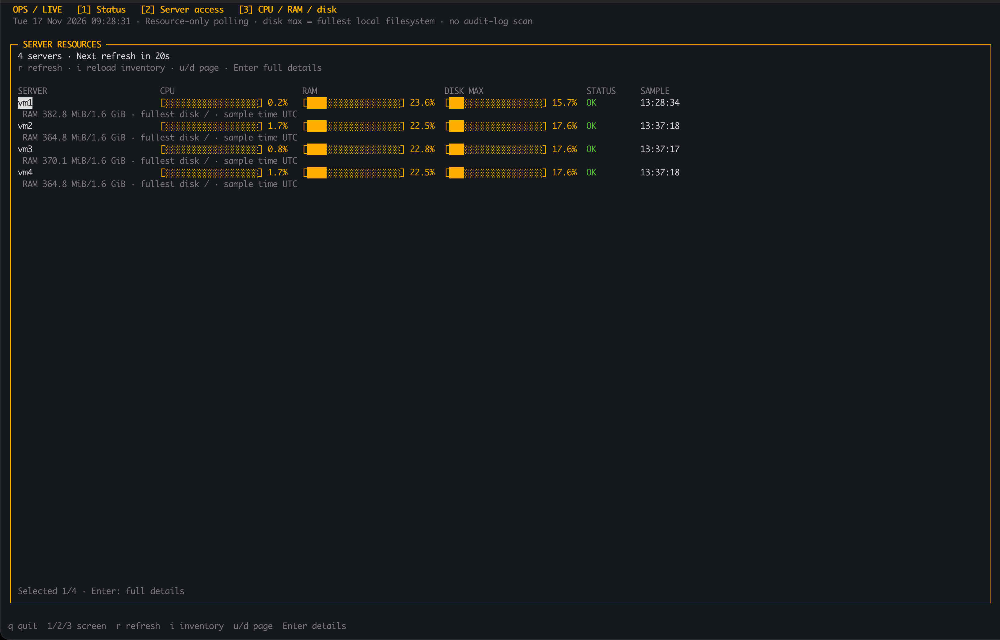

# Ops dashboard

A terminal dashboard for SSL checks, HTTP probes, Supervisor status, Linux
access logs, live resource usage, and three-day metrics charts.

## Screenshots





Press `1`, `2`, `3` or `4` to switch pages. On page 2, use `l`, `f`, `U` and `c` to show
logins, files, users and cron. Use a wide terminal so all the panels fit.

## Requirements

- macOS or Linux, Python 3.9+, OpenSSL, OpenSSH and Ansible.
- Python's `curses` and `ssl` modules.
- Linux servers with Python 3, SSH access and root/sudo permission for setup.
- A terminal at least 60 columns by 16 rows. Use 110+ columns for all panels.

Installing Ansible:

```sh
# Debian / Ubuntu
sudo apt install ansible

# macOS
brew install ansible
```

## Inventory

The dashboard and playbook both use `servers.ini`. It is a normal Ansible
inventory, parsed by `ansible-inventory`.

```ini
[servers]
web01 ansible_host=192.0.2.20 ansible_user=monitor ansible_port=22022

[all:vars]
ansible_ssh_private_key_file=~/.ssh/monitor_key

[supervisor_hosts]
jobs ansible_host=192.0.2.10 ansible_user=monitor ansible_port=2222

[supervisor_hosts:vars]
supervisor_command=sudo -n supervisorctl status
supervisor_interval=120
supervisor_enabled=true
```

Use `ansible_host`, `ansible_user`, `ansible_port` and
`ansible_ssh_private_key_file` for connection settings. Omitted settings use
your SSH configuration. Ansible groups and group variables work too.

Put one host in `[supervisor_hosts]` to enable Supervisor. Leave that group
empty, remove it, or set `supervisor_enabled=false` to disable the panel.
Hosts in `[supervisor_hosts]` are monitoring-only. The setup playbook skips
them entirely, including fact gathering. Access, resource and history scans skip them too.
Supervisor must already be installed and its status command must work without
a password prompt. In `:vars` sections, write commands without outer quotes.

## Load SSH keys

Connect to each new server first and check its host fingerprint. Load encrypted
keys in the terminal where you will run the dashboard:

```sh
ssh-add ~/.ssh/monitor_key
ssh-add -l
```

If there is no SSH agent:

```sh
eval "$(ssh-agent -s)"
ssh-add ~/.ssh/monitor_key
```

## Set up the servers with Ansible

From the project folder:

```sh
ansible-playbook -i servers.ini ansible/setup.yml --syntax-check
ansible-playbook -i servers.ini ansible/setup.yml -K
```

`-K` asks for the setup sudo password. Omit it if setup already has passwordless
sudo. To set up just one server:

```sh
ansible-playbook -i servers.ini ansible/setup.yml --limit web01 -K
```

The playbook supports Debian/Ubuntu and RHEL-family servers. It installs the
collector and auditd, starts auditing, and grants the SSH user access to the
collector. It adds account and cron audit rules for paths that exist. Other
audit rule files are kept. If audit rules are locked, a reboot is needed to
load changes.

It also installs `ops-dashboard-metrics.timer`. This records CPU, RAM, disk
usage, disk I/O and network I/O every minute, even when the app is closed.
History stays on each server in `/var/lib/ops-dashboard/metrics.sqlite3` for
three days. Supervisor hosts are excluded from all setup tasks.

For other file activity, edit these lists in `ansible/setup.yml` and rerun it:

```yaml
ops_audit_read_paths:
  - /srv/app
ops_audit_write_paths:
  - /srv/app
```

Choose existing paths. Read auditing on busy directories can produce many logs.
History starts when rules are enabled. Rerun the playbook to update an installed
collector after changing its code.

The default allowed audit lookback is 24 hours. To use another value, add it to
`ops_collector_hours` in the playbook and rerun setup.

## Run it

```sh
./ops-dashboard
```

Put sites in `domains.txt`, one hostname or URL per line:

```text
example.com
https://app.example.com/health
```

SSL and probes run manually. SSL checks port 443; HTTP probes use the full URL.
Supervisor uses its inventory refresh interval.

Press `2` to scan server access. It shows logins, audited file activity,
accounts and cron changes. The first scan saves a baseline. Snapshot changes
only show that something changed between scans; audit records provide the
actor and operation when available.

Press `3` for CPU, RAM, swap and disk usage for inventory hosts. It refreshes every
30 seconds while that screen is open. CPU uses a one-second sample. RAM uses
available memory. The disk column shows the fullest local filesystem; Enter
shows all collected mounts. Network and temporary filesystems are excluded.
Swap shows used space as a percentage of total swap; `OFF` means no swap is configured.
Usage at 80% is a warning; 95% is critical. Failed polls keep previous values
marked stale. Resource refreshes do not scan audit logs.

Press `4` for the past three days of metrics. Use Up/Down or `n`/`p` to switch
servers and `u`/`d` to see more charts on smaller terminals. Charts refresh
every minute over SSH. Press `t` to cycle through 4h, 8h, 1d, 2d and 3d.
Use `[` / `]` for the previous / next range. The default is 3d. Charts and
summaries use the selected range. All charts use UTC. Enter opens a summary.

History starts after you run the updated playbook. Allow a minute for the
first sample and two for I/O rates. Missing data stays blank; old history
cannot be recovered. CPU readings are one-second samples taken each minute.
Chart columns show averages, with shading for the range of recorded values.
Network rates total all non-loopback interfaces; bridges and VPNs may count
traffic twice. Disk usage shows the fullest local filesystem. Disk I/O shows
read/write rates for whole devices, excluding loop/ram devices and backing
devices with holders. Reboots and counter resets leave gaps in I/O rates.

Check the server timer:

```sh
sudo systemctl status ops-dashboard-metrics.timer --no-pager
sudo journalctl -u ops-dashboard-metrics.service -n 20 --no-pager
```

## Keys

| Key | Action |
| --- | --- |
| `1` / `2` / `3` / `4` | Status / server access / resources / history |
| `c` / `p` on screen 1 | Run SSL / HTTP probes |
| `r` | Refresh the current screen |
| Tab | Switch panels |
| Up/Down or `k`/`j` | Select a row |
| `u` / `d` or PgUp/PgDn | Page up / down |
| Enter on the server list | Scan that server |
| Enter elsewhere | Open full-screen details |
| Escape, Enter or `q` in details | Return to the list |
| Home/End in details | Jump to the top / bottom |
| `l` / `f` / `U` / `c` on screen 2 | Logins / files / users / cron |
| `a` on screen 2 | All activity |
| `i` on screen 2, 3 or 4 | Reload inventory |
| Up/Down or `n`/`p` on screen 4 | Switch servers |
| `u` / `d` on screen 4 | Previous / next charts |
| `t` or `[` / `]` on screen 4 | Change time range: 4h, 8h, 1d, 2d, 3d |
| `q` or Ctrl-C | Quit |

## Arguments

| Argument | Default |
| --- | --- |
| `--inventory PATH` | `servers.ini` beside the app |
| `--domains PATH` | `domains.txt` beside the app |
| `--page status\|access\|resources\|history` | `status` |
| `--server NAME` | All hosts on access/resources/history screens |
| `--resource-interval SECONDS` | `30` |
| `--history-hours HOURS` | `72`; choices: 4, 8, 24, 48, 72 |
| `--audit-hours HOURS` | `24`, allowed range 1–168 |
| `--state-dir PATH` | `~/.local/state/ops-dashboard` |
| `--cert-script PATH` | Bundled `check_certs.py` |
| `--http-script PATH` | Bundled `check_http.py` |
| `--once` | Print the chosen screen's checks once and exit |
| `--help` | Show help |

```sh
./ops-dashboard --page history
./ops-dashboard --page history --history-hours 4
./ops-dashboard --page history --server web01
./ops-dashboard --page resources
./ops-dashboard --page resources --server web01 --resource-interval 10
./ops-dashboard --page resources --once
./ops-dashboard --page access --server web01
```
