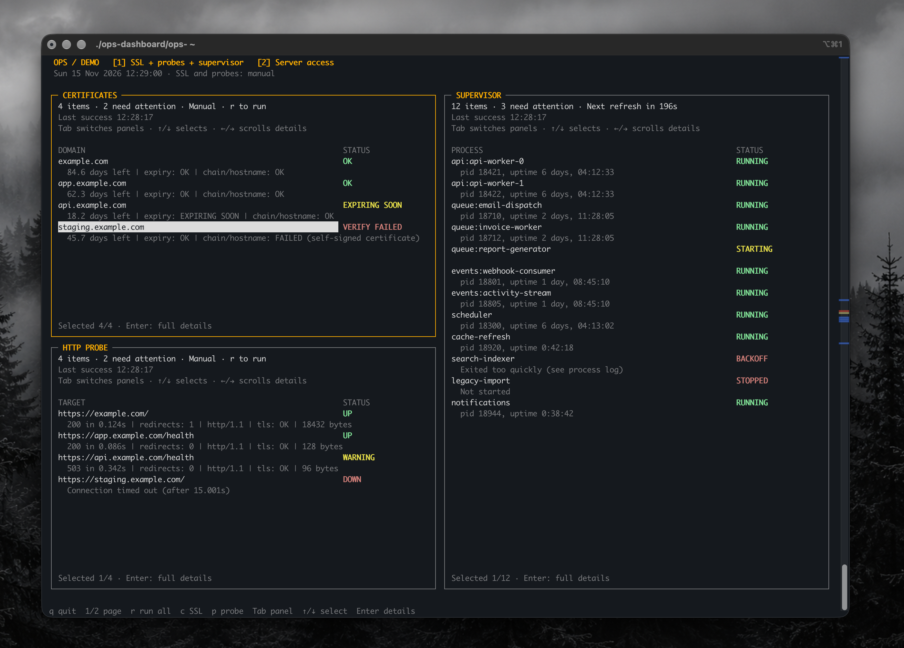

# Ops dashboard

A terminal app for checking SSL certificates, website availability and Supervisord jobs. <br>
There is a second page which provides visibility into successful SSH logins, including usernames, source IP addresses, and timestamps. <br> It also displays audited file access and modification events, account-management activity, and changes to system and user cron files.

## Prerequisites
- macOS or Linux (Windows not tested).
- Python 3.9 or newer, available as `python3`, with the `curses` and `ssl`
  modules.
- OpenSSL, available as `openssl`, for reading certificate expiry dates.
- A working CA certificate store for Python, so HTTPS certificates can be
  verified.

## Screenshots




Press `1` or `2` to switch pages. On page 2, use `l`, `f`, `U` and `c` to show
logins, files, users and cron. Use a wide terminal so all the panels fit.

## Keys
| Key | Action |
| --- | --- |
| `1` / `2` | Status page / server access page |
| `c` / `p` on page 1 | Run SSL / HTTP probes |
| `r` on page 1 | Run all three status checks |
| `r` on page 2 | Scan the selected server |
| Tab | Switch panels |
| Up/Down or `k`/`j` | Select a row and scroll |
| `u` / `d` or PgUp/PgDn | Page up / page down in the active panel on either page, or in full-screen details |
| Enter on servers | Scan the selected server |
| Enter elsewhere | Open full-screen details |
| Up/Down or `k`/`j` in details | Scroll one line |
| Home/End or `g`/`G` in details | Jump to the top / bottom |
| Escape, Enter or `q` in details | Close details and return to the list |
| `l` / `f` / `U` / `c` on page 2 | Logins / files / users / cron |
| `a` on page 2 | All events |
| `i` on page 2 | Reload inventory |
| `q` or Ctrl-C | Quit |

Use lowercase `u` for page up. The Users filter uses uppercase `U` (Shift+u).
## SSH and Supervisor

Set up an alias in `~/.ssh/config`:

```sshconfig
Host job-server
    HostName 192.0.2.10
    User monitor
    Port 2222
    IdentityFile ~/.ssh/monitor_key
```

Connect normally first, check the host fingerprint, then exit. If your key has
a passphrase, load it in the same terminal where you will run the app:

```sh
ssh job-server
ssh-add ~/.ssh/monitor_key
ssh-add -l
ssh -T -o BatchMode=yes job-server 'sudo -n supervisorctl status'
```

`ssh-add` unlocks the key for the SSH agent. It does not change the key file or
copy it to the server. Load it again if the agent no longer has it. Remove it
with `ssh-add -d ~/.ssh/monitor_key` when you want.

Supervisor gets its configuration from `servers.ini`. Define the server and
select it in a `[supervisor]` section:

```ini
[servers]
jobs host=192.0.2.10 user=monitor port=2222 identity_file=~/.ssh/monitor_key

[supervisor]
server=jobs
command="sudo -n supervisorctl status"
interval=120
```

Then run `./ops-dashboard`. The `server` value must match an inventory entry.
If that entry is an SSH alias and you omit its connection options, SSH still
uses its usual config for the selected alias.

`interval` is in seconds (default: 240). The default command is
`sudo -n supervisorctl status`; change it to `supervisorctl status` if the
account has direct access. The app does not restart jobs. `sudo` on a server
entry controls the audit collector, not the Supervisor command.

An empty inventory, a missing or empty `[supervisor]` section, or
`enabled=false` in that section disables the Supervisor panel without an SSH
connection. Invalid settings are shown as errors. No Supervisor host is assumed.
Settings are read before each Supervisor refresh. After editing the file, press
`r` on page 1 to apply them immediately, including enabling a disabled panel.

## Run it

```sh
./ops-dashboard
```

## Domains and manual checks

Put one hostname or URL per line in `domains.txt`:

```text
example.com
https://app.example.com/health
```

SSL and HTTP probes are manual. They do not run at startup or on a timer.
Press `c` for SSL, `p` for HTTP probes, or `r` to run all checks on page 1.
The domains file is read again each time.

## Install the server collector

#### This will become an ansible playbook in feature releases!
Do this once for each server. Replace the example user, address and SSH port
with your own values.

1. On your Machine, open a terminal in the app folder and upload the collector:

```sh
scp -P 2222 collect_server.py monitor@192.0.2.20:/tmp/ops-dashboard-collect.py
ssh -p 2222 monitor@192.0.2.20
```

2. You are now on the Linux server. Install the file at the default location:

```sh
sudo install -d -o root -g root -m 755 /usr/local/libexec
sudo install -o root -g root -m 755 /tmp/ops-dashboard-collect.py /usr/local/libexec/ops-dashboard-collect
sudo /usr/local/libexec/ops-dashboard-collect 24
```

The last command should print JSON.

3. On the server, open a sudoers file:

```sh
sudo vim /etc/sudoers.d/ops-dashboard
```

Add this line, replacing `monitor` with the SSH user, then save and quit:

```sudoers
monitor ALL=(root) NOPASSWD: /usr/local/libexec/ops-dashboard-collect 24
```

Set the file permissions:

```sh
sudo chmod 440 /etc/sudoers.d/ops-dashboard
```

4. Back on your Machine, test the same command the app will use:

```sh
ssh -p 2222 monitor@192.0.2.20 'sudo -n /usr/local/libexec/ops-dashboard-collect 24'
```

It should print JSON without a sudo password prompt. If it works, add that
server to `servers.ini`, start the app and press `2`.

Leave `sudo` unset for this setup. If you change `--audit-hours`,
update the permitted number in the sudoers rule too. The app accepts 1 to 168
hours. The server needs auditd and rules for file history; see the next sections.

The collector reads logs and metadata. It does not install or configure auditd.

## Install auditd

Run this on each Linux server, not on the Machine. Check what is already installed:

```sh
cat /etc/os-release
command -v auditctl
sudo systemctl status auditd
```

Debian or Ubuntu:

```sh
sudo apt update
sudo apt install auditd wtmpdb
sudo systemctl enable --now auditd
```

RHEL, Rocky Linux, AlmaLinux or Fedora:

```sh
sudo dnf install audit
sudo systemctl enable auditd
sudo service auditd start
```

Check the status and rules:

```sh
sudo auditctl -s
sudo auditctl -l
```

`enabled 1` means enabled. `enabled 2` means rules are locked until reboot.
The `pid` should be nonzero and `lost` should be zero. A service restart does
not unlock immutable rules. A container may not be allowed to manage host audit.

## Set up audit rules

Installing auditd does not record every file read. Choose which paths to watch.
These examples use 64-bit Linux rules. On x86-64, add matching `arch=b32` rules
if you also need to track 32-bit programs.

Use `sudo vim /etc/audit/rules.d/70-ops-dashboard.rules`. For account and cron
changes, add the lines for paths that exist on your server:

```text
-a always,exit -F arch=b64 -F path=/etc/passwd -F perm=wa -k ops_dashboard
-a always,exit -F arch=b64 -F path=/etc/group -F perm=wa -k ops_dashboard
-a always,exit -F arch=b64 -F path=/etc/shadow -F perm=wa -k ops_dashboard
-a always,exit -F path=/etc/gshadow -F arch=b64 -F perm=wa -k ops_dashboard
-a always,exit -F arch=b64 -F path=/etc/crontab -F perm=wa -k ops_dashboard
-a always,exit -F arch=b64 -F dir=/etc/cron.d/ -F perm=wa -k ops_dashboard
-a always,exit -F arch=b64 -F dir=/var/spool/cron/ -F perm=wa -k ops_dashboard
```

Add similar rules for `/etc/anacrontab` and `/etc/cron.hourly`, `cron.daily`,
`cron.weekly` and `cron.monthly` if you use them. Remove lines for missing paths.

For reads and writes in a directory, replace `/srv/myapp/` with a real path:

```text
-a always,exit -F arch=b64 -F dir=/srv/myapp/ -F perm=r -k ops_dashboard_read
-a always,exit -F arch=b64 -F dir=/srv/myapp/ -F perm=wa -k ops_dashboard_write
```

`r` means read/open access, `w` means write access and `a` means attribute
changes. This also records service activity. Start with a small directory;
read auditing on a busy tree can produce lots of logs. Directory rules do not
cross mount points. A read event is not proof someone viewed the file on screen.

Load and check the rules:

```sh
sudo augenrules --load
sudo auditctl -l
```

Check errors, missing paths, locked rules and any existing rules that disable
syscall auditing. Keep other applications' rules. You do not need `auditctl -D`.

Try reading a file in your watched directory, then search the events:

```sh
cat /srv/myapp/example.txt
sudo ausearch -k ops_dashboard_read -ts recent -i
sudo ausearch -k ops_dashboard_write -ts today -i
sudo ausearch -k ops_dashboard -ts today -i
sudo ausearch -m ADD_USER,DEL_USER,USER_MGMT -ts today -i
sudo ausearch -m USER_LOGIN -ts today -i
```

`auid` is the original login UID. `uid` and `euid` are the process identities.
The login UID can stay tied to the original user after sudo. Some service
activity has no login UID.

Audit logs normally live in `/var/log/audit/`. Set rotation and disk limits in
`/etc/audit/auditd.conf`. Records disappear when logs rotate out. The app is not
a full log archive and cannot protect logs from root on the server.

References: [auditctl](https://man7.org/linux/man-pages/man8/auditctl.8.html),
[ausearch](https://man7.org/linux/man-pages/man8/ausearch.8.html),
[Red Hat audit guide](https://docs.redhat.com/en/documentation/red_hat_enterprise_linux/8/html/security_hardening/auditing-the-system_security-hardening),
[Ubuntu auditd package](https://packages.ubuntu.com/jammy/admin/auditd).

## What server access shows

- Successful SSH authentication from the journal: user, IP and time. This does
  not necessarily mean the user opened an interactive shell.
- Successful audit login events and recent `last` session records.
- File events from the configured rule keys, with user IDs, session, executable
  and paths when the server recorded them.
- Account-management audit events, plus account additions/removals/changes
  found between scans. The account list uses NSS, so it can include LDAP users.
- Cron audit events and changes to cron metadata/hashes between scans.
- Missing permissions, commands, audit rules and collection limits.

The first successful scan saves a baseline. Snapshot changes are only known to
have happened between scans. They do not identify the actor or exact time.
Password hashes and cron contents are not stored on the Machine. Systemd timers

are not part of the cron check.

Audit and journal event times use UTC. `last` output keeps server-local time
and is not restricted by the audit lookback. File events usually do not contain
the client IP. The app does not guess it; an audit session ID may help connect
the event with a login during an investigation.

Snapshots and the newest 500 snapshot change records per server are stored in
`~/.local/state/ops-dashboard`. Use `--state-dir` to change that. Removing state
starts a new baseline. Audit/journal events are read from the server each scan.

A scan reads at most 800 SSH journal entries, 100 `last` entries and a 1 MB tail
per audit query. Limits and collection errors are shown. Missing history does
not mean nothing happened. File activity from before auditing was configured
cannot be recovered by this app.

## Command-line options

Run these from the app folder. Options can be combined, for example:

```sh
./ops-dashboard --page access --server web01 --audit-hours 24
```

| Option | What it does | Default |
| --- | --- | --- |
| `--help` or `-h` | Show the options and exit | — |
| `--page status\|access` | Choose the starting page, or the page to scan with `--once` | `status` |
| `--inventory PATH` | Use another server inventory | `servers.ini` beside the app |
| `--server NAME` | Only load this inventory alias on the access page | All inventory servers |
| `--audit-hours HOURS` | Audit/journal lookback, from 1 to 168 hours | `24` |
| `--state-dir PATH` | Where account/cron snapshots are saved | `~/.local/state/ops-dashboard` |
| `--domains PATH` | Use another domains file | `domains.txt` beside the app |
| `--cert-script PATH` | Use another compatible certificate checker | Bundled `check_certs.py` |
| `--http-script PATH` | Use another compatible HTTP checker | Bundled `check_http.py` |
| `--once` | Run the selected page's checks once, print results and exit | Off |

Both pages use `--inventory` to select their INI file. Supervisor uses its
`[supervisor]` section and the named server entry. `--server` only filters the
access page; it does not change which server the Supervisor section selects.
The former Supervisor connection/command/interval CLI options were removed;
configure these in the INI file instead.

Examples:

```sh
./ops-dashboard --once
./ops-dashboard --page access --once
./ops-dashboard --inventory ./production.ini --page access --server web01
./ops-dashboard --audit-hours 48
./ops-dashboard --domains ./other-domains.txt
./ops-dashboard --help
```

`--once` runs the chosen page's checks once, including manual checks. It does
not enable an SSL or probe timer.
